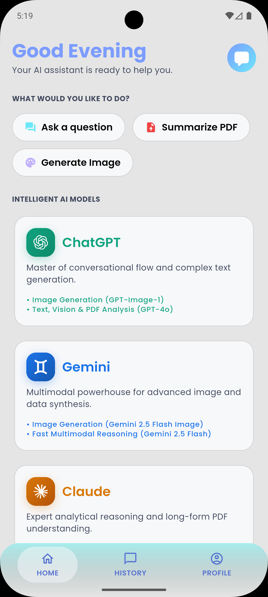
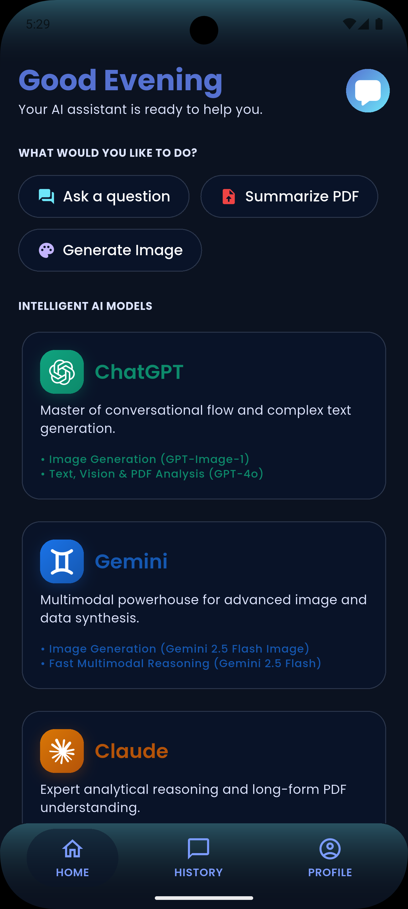
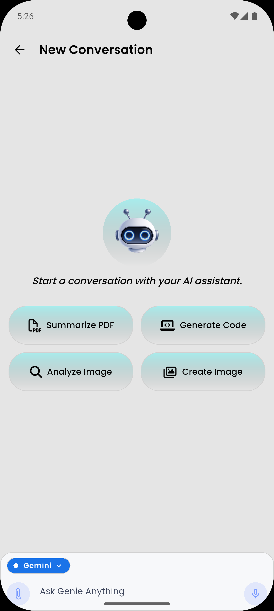
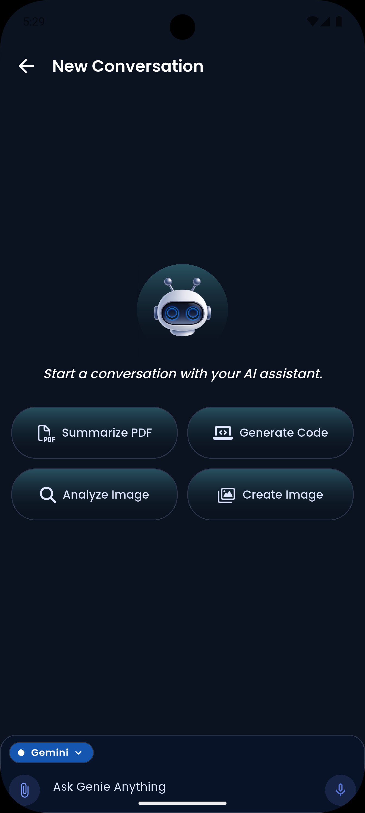
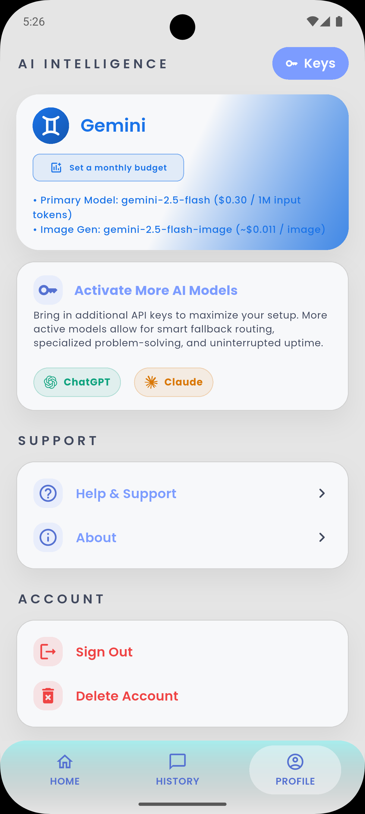
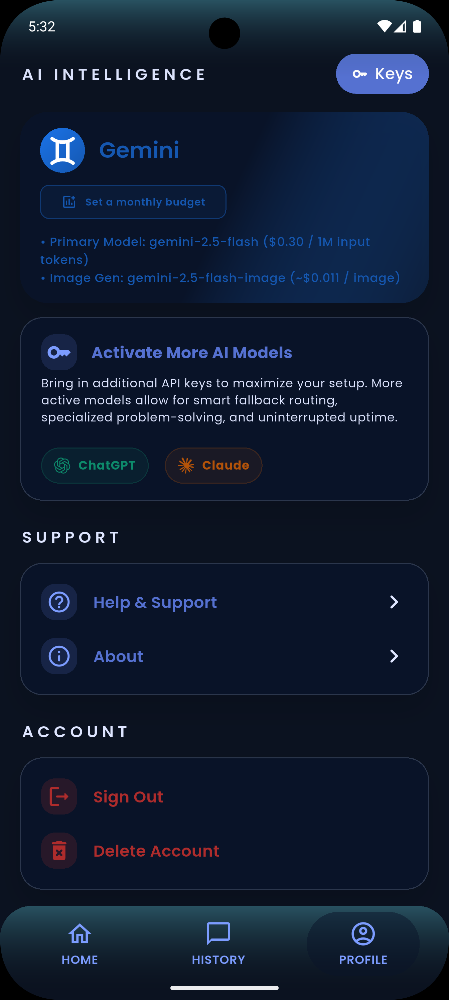

> *Note: Click on the logo to download the latest release APK file directly to your Android device.*

<p align="left">
  <a href="https://github.com/ArpitAswal/AI-Voice-Genie/releases/download/v1.2.0/app-arm64-v8a-release.apk">
    
  </a>
</p>
<br>

<h3>&nbsp;&nbsp;AI Voice Genie</h3>
<p>&nbsp;&nbsp;&nbsp;<b>Enterprise-Grade, Unified Multi-Model AI Assistant Engine for Mobile</b></p>
<br clear="left"/>

<p align="center">
  
  
  
  
  
  
  
</p>
<p align="center">
  
  
  
  
  
</p>

---

## 📝 Executive Overview

> [!IMPORTANT]
> **Device & Platform Compatibility**
> - **Platform Tested**: Rigorously validated on **Android physical hardware**. The architecture is fully cross-platform (iOS compatible), with native channel verification in progress.
> - **Form Factor Focus**: Engineered specifically for **mobile phone form factors** to guarantee peak performance and ergonomic touch interactions.

**AI Voice Genie** is an enterprise-grade mobile application that consolidates the world's most advanced AI ecosystems into a single, high-performance interface. Rather than forcing users to juggle fragmented subscriptions across siloed applications, AI Voice Genie unites **OpenAI**, **Google Gemini**, and **Anthropic Claude** within a private, local-first mobile client.

Engineered around a **Bring Your Own Key (BYOK)** paradigm, the platform delivers zero-markup access and complete user sovereignty over AI credentials. Users seamlessly alternate across frontier models:
* **OpenAI**: `gpt-6-luna` (Advanced Reasoning, Vision, PDF Intelligence, Document Generation) and `gpt-image-2.5-flare` (High-Fidelity Image Generation).
* **Google Gemini**: `gemini-3.5-flash-lite` (High-Speed Multimodal Intelligence), `gemini-3.1-flash-lite-image` (Native Aspect-Ratio Image Generation), and `gemini-3.8-flash` (Deep Analytical Reasoning with Configurable Thinking Depth).
* **Anthropic Claude**: `claude-haiku-4-5-20251001` (Complex Code Generation, Nuanced Analytical Synthesis, and Dense Document Analysis).

Built with a **Local-First Architecture** utilizing **Hive NoSQL**, all conversations render with sub-millisecond latency. An autonomous background outbox engine queues offline mutations and guarantees consistency by reconciling with **Cloud Firestore** upon reconnection. Enhanced with real-time continuous voice recognition, native on-device PDF document compilation, hardware-backed keystore encryption, and OS-level screenshot defense, AI Voice Genie represents a new benchmark for private, multi-model mobile AI clients.

---

## 📱 Product Preview

Meticulously crafted with responsive, adaptive Light and Dark themes:

| Light Theme | Dark Theme |
|:---:|:---:|
| **Home Discovery**<br> | **Home Discovery**<br> |
| **Interactive Chat**<br> | **Interactive Chat**<br> |
| **Intelligence & Settings**<br> | **Intelligence & Settings**<br> |
| **BYOK Key Management**<br> | **BYOK Key Management**<br> |
| **Conversation History**<br> | **Conversation History**<br> |

| **Voice Assistant Demonstration** |
|:---:|
| https://github.com/user-attachments/assets/7a4f6b07-e389-4baf-9940-1a2515f3ae66 |

---

## 🤖 Model Portfolio & Capability Matrix

AI Voice Genie standardizes disparate provider schemas through an intelligent orchestration engine (`AiOrchestrator`):

| Provider | Model Identifier | Primary Modalities & Capabilities | Cost Metrics (1M Tokens / Image) |
|---|---|---|---|
| **OpenAI** | `gpt-6-luna` | Text Synthesis, Vision Analysis, Document Parsing, PDF Generation | $2.50 prompt / $10.00 completion |
| **OpenAI** | `gpt-image-2.5-flare` | Visual Synthesis with Standard & HD Quality Tiers | $0.011 – $0.167 per generated image |
| **Google** | `gemini-3.5-flash-lite` | High-Speed Text, Multimodal Vision, Real-Time Inline PDF Ingestion | $0.075 prompt / $0.30 completion |
| **Google** | `gemini-3.1-flash-lite-image` | Visual Generation (`1:1`, `16:9`, `9:16`) across `1K`, `2K`, and `4K` Tiers | $0.020 per generated image |
| **Google** | `gemini-3.8-flash` | Deep Multi-Step Logic with Configurable Thinking Depth (`low`, `medium`, `high`) | $0.15 prompt / $0.60 completion |
| **Anthropic** | `claude-haiku-4-5-20251001` | Technical Code Generation, Rigorous Logic, Complex Document Synthesis | $3.00 prompt / $15.00 completion |

---

## ⚙️ Adaptive Intelligence & Client Optimization

AI Voice Genie implements dynamic, capability-aware client preferences managed by `AiPreferencesProvider` and validated via `ProviderRegistry`:

- **Dynamic Capability Filtering**: The user interface adapts in real time to the selected model. Selecting **Claude** cleanly hides visual synthesis controls to prevent invalid invocations, while selecting **Gemini** exposes native aspect-ratio selectors (`1:1`, `16:9`, `9:16`), resolution quality tiers (`1K`, `2K`, `4K`), and reasoning thinking budgets.
- **Granular Model Fine-Tuning**: Exposes pixel dimensions (`1024x1024`, `1024x1536`, `1536x1024`), image rendering styles (Auto, Opaque, Transparent), and vision detail levels (`auto`, `low`, `high`) for OpenAI.
- **Pre-Flight Sanitization**: `ProviderRegistry.sanitizePreferences()` strips unsupported parameters from payloads prior to network dispatch, eliminating HTTP 400 Bad Request errors.
- **Prompt Normalization Engine**: Automatically cleans leading conversational salutations (e.g. "Hey Genie", "Hello Claude") across **OpenAI, Google Gemini, and Anthropic Claude** prompts. This maximizes LLM attention windows and avoids repetitive conversational echoes. Follow-up inquiries (e.g., "Thanks for your explanation, now can you...") preserve the complete substantive inquiry, and pure pleasantries fall back safely to preserve original intent.

---

## 📊 Telemetry, Accounting & Budget Governance

To deliver transparent visibility into AI resource consumption, AI Voice Genie features built-in usage accounting in `ProfileView`:

- **Granular Token Accounting**: Real-time auditing of Prompt Tokens, Completion Tokens, and Total Tokens consumed per request.
- **Automated Expense Estimation**: Instantly computes exact USD expenditures per transaction based on verified `UsagePricingTable` metrics.
- **Configurable Spending Limits**: Users define monthly budget thresholds. The client renders dynamic visual consumption meters and displays non-blocking alerts when consumption approaches 80% or 100% of limits.
- **Zero-Latency Persistence**: Telemetry is cached locally in Hive for instant inspection and synchronized to user-isolated Cloud Firestore records.

---

## 🔒 Enterprise Security & Privacy Architecture

Security is architected as a core pillar across the device, network, and cloud layers:

- 🛡️ **OS-Level Screen Protection (`FLAG_SECURE`)**: The API key management surface (`KeySetupScreen`) enforces native `FLAG_SECURE` window buffering on Android and secure snapshot masking on iOS, preventing screen capture, background recording, and multitasking switcher leaks.
- 🔑 **Hardware-Backed Cryptographic Storage**: User API keys are encrypted at rest using AES-256 (`encrypt`) and sealed within the Android Keystore and iOS Keychain (`flutter_secure_storage`).
- 🎭 **Client Memory Obfuscation**: Keys are dynamically masked (`sk-a...789`) in memory to prevent visual shoulder-surfing.
- ☁️ **Zero-Knowledge Cloud Records**: Cloud Firestore backups are protected by user-isolated security rules that enforce strict authenticated owner-only access.
- 🔐 **OAuth Verification**: Google OAuth sign-in integrates SHA-256 cryptographic nonces (`crypto`) to eliminate replay attacks.
- 🗑️ **Atomic Account Destruction**: Account deletion permanently purges remote cloud records, wipes encrypted keys, resets local Hive storage, and deletes the authentication profile.

---

## ✨ Strategic Capabilities

- 🤖 **Multi-Model BYOK Ecosystem**: Native client-side support for OpenAI (`gpt-6-luna`, `gpt-image-2.5-flare`), Google Gemini (`gemini-3.5-flash-lite`, `gemini-3.1-flash-lite-image`, `gemini-3.8-flash`), and Anthropic Claude (`claude-haiku-4-5-20251001`).
- ⚡ **Local-First Zero-Latency UI**: Hive NoSQL database delivers instant application startup and immediate message rendering.
- 🗂️ **Batch & Granular Conversation Management**: Select multiple conversations with bulk deletion or clear individual sessions atomically across local Hive and Cloud Firestore.
- 🔄 **Durable Offline Outbox Sync**: Mutations performed offline are durably enqueued as `ChatOutboxTask` items and processed with exponential backoff when connectivity returns.
- 📜 **Cursor-Based Infinite Pagination**: Memory-efficient pagination ($O(1)$ RAM footprint) ensures 60–120fps scrolling even with extensive conversation archives.
- 📄 **On-Device Compiled PDF Reports**: Compiles structured AI markdown into publication-quality binary PDFs (`PdfDocumentService`) with native document preview and public Downloads export.
- 💡 **Curated Action Starters**: One-tap conversation starters for PDF Summarization, PDF Report Generation, Code Writing, Image Analysis, and Visual Creation.
- 🎙️ **Continuous Speech-to-Text (STT) & Auto-TTS**: High-accuracy on-device continuous microphone dictation with automatic grammar and punctuation formatting, plus text-to-speech audio synthesis.
- 🖼️ **Multimodal Vision & PDF Ingestion**: Native image analysis and direct base64 PDF document streaming across Gemini, Claude, and OpenAI.
- 💾 **Native Scoped Gallery Saving**: Scoped MethodChannels (`Pictures/AI Voice Genie` on Android MediaStore API 29+, `Photos` on iOS) save images without broad permissions.
- 🔔 **Dynamic Status Messaging**: Layered notification system (`StatusMessageUtils`) with severity priority (Error > Warning > Success), deduplication, and swipe gestures.
- 🌐 **Multilingual & Theming**: Instant localization (English and Hindi) alongside adaptive Light, Dark, and System display modes.

---

## ⚙️ System Design & Architecture

AI Voice Genie is built on a **Feature-First Clean MVVM (Model-View-ViewModel)** architectural pattern:

```text
┌─────────────────────────────────────────────────────────────────────────────┐
│                            PRESENTATION LAYER                               │
│  UI Screens & Views:                                                        │
│  • SplashScreen, AuthScreen, OnboardingScreen, KeySetupScreen               │
│  • TabBarScreen (Intro / Home, History, Profile), ChatScreen, LegalScreen   │
│                                                                             │
│  ViewModels & State Providers:                                              │
│  • AuthProvider, ChatProvider, ProfileViewModel                             │
│  • AiPreferencesProvider, VoiceSpeechProvider, UsageProvider                │
└──────────────────────────────────────┬──────────────────────────────────────┘
                                       │ State Observation & User Intents
                                       ▼
┌─────────────────────────────────────────────────────────────────────────────┐
│                                DOMAIN LAYER                                 │
│  Business Entities:                                                         │
│  • UserModel, ConversationModel, MessageModel, ChatAttachment               │
│  • ChatOutboxTask (Offline Mutation Queue), ChatPdfInfo, UsageAuditRecord   │
│                                                                             │
│  Repository Interfaces (Contracts):                                         │
│  • AuthRepository, ChatRepository, ApiKeyRepository                         │
│  • UsageRepository, VoiceSpeechRepository, CloudSyncRepository              │
└──────────────────────────────────────┬──────────────────────────────────────┘
                                       │ Implements Interfaces
                                       ▼
┌─────────────────────────────────────────────────────────────────────────────┐
│                                 DATA LAYER                                  │
│  Repositories & Data Stores:                                                │
│  • AuthRepositoryImpl, ChatRepositoryImpl, UsageRepositoryImpl              │
│  • LocalChatStore & MessageDao (Hive NoSQL - Sub-millisecond reads)         │
│  • ChatOutboxStore & ChatSyncService (Offline-First sync engine)            │
│  • ApiKeyRepositoryImpl (AES-256 + Android Keystore / iOS Keychain)         │
│  • PdfDocumentService (Pure-Dart client-side Markdown-to-PDF compiler)      │
└──────────────────────────────────────┬──────────────────────────────────────┘
                                       │ Network & Native OS Dispatches
                                       ▼
┌─────────────────────────────────────────────────────────────────────────────┐
│                            INFRASTRUCTURE LAYER                             │
│  External Services & Platform Integrations:                                 │
│  • Multi-Model AI Orchestrator (OpenAI, Google Gemini, Anthropic Claude)     │
│  • Firebase Cloud Backend (Auth, Firestore, Cloud Storage, Analytics, Crashlytics)│
│  • Device Native Channels: SpeechToText, FlutterTTS, Scoped MediaStore/Photos│
│  • Security Hardware Gate: FLAG_SECURE window protection (no_screenshot)    │
└─────────────────────────────────────────────────────────────────────────────┘
```

### 🧱 Layer Responsibilities & Technical Breakdown

| Architectural Layer | Core Components | Primary Responsibilities |
|---|---|---|
| **Presentation Layer** | Screens, Widgets, ViewModels (`Provider`) | Renders UI state, captures user touch and voice input, and drives reactive screen updates. |
| **Domain Layer** | Entities, Repository Interfaces, Enums | Encapsulates core business models, contract abstractions, and business rules independent of external frameworks. |
| **Data Layer** | Repositories, `LocalChatStore` (`Hive`), `ChatSyncService`, `PdfDocumentService` | Manages local caching, optimistic offline writes, keystore encryption, and client PDF compilation. |
| **Infrastructure Layer** | `AiOrchestrator`, Firebase SDK, MethodChannels, `no_screenshot` | Communicates directly with AI REST endpoints, Cloud Firestore, device hardware, and OS security APIs. |

### 🔄 Architectural Data Flow

1. **User Action / Voice Input**: The user inputs a prompt or speaks via continuous speech-to-text (`speech_to_text`).
2. **ViewModel Orchestration**: The corresponding ViewModel (`ChatProvider`) captures the intent, sanitizes parameters through `ProviderRegistry`, and writes an optimistic message immediately to `LocalChatStore` (Hive).
3. **AI Dispatch**: `AiOrchestrator` constructs the provider payload (OpenAI, Gemini, or Claude) with attached base64 images or PDF documents.
4. **Response Ingestion**: The LLM response stream or completion updates the local Hive box and calculates token expenditures via `UsagePricingTable`.
5. **Background Sync**: `ChatSyncService` queues mutations into `ChatOutboxTask` and reconciles with Cloud Firestore in the background.

---

## 🧠 Advanced Engineering & Core Algorithms

1. **Cursor-Based Lexicographical Pagination ($O(1)$ Memory Overhead)**: Avoids bulk loading entire database tables. Sorts compound keys (`timestamp_conversationId`) and selectively hydrates discrete segments (15 conversations or 20 messages), maintaining a fixed memory footprint.
2. **Eventual Consistency with Exponential Backoff**: Offline operations write optimistically to Hive while queueing serialized `ChatOutboxTask` items. When `connectivity_plus` signals internet restoration, the queue drains asynchronously using exponential backoff.
3. **Real-Time Speech Grammar Heuristics**: Audio streams are intercepted and passed through a regex pipeline that capitalizes proper nouns (e.g. "OpenAI", "Claude", "Gemini"), structures vocative commas, and appends punctuation to interrogative clauses.
4. **Client-Side Markdown-to-PDF Compilation**: The application compiles structured AI markdown responses directly into styled binary PDF documents on-device without cloud rendering dependencies.
5. **Zero-Trust Security & Screen Obfuscation**: Enforces hardware Keystore encryption, memory masking, and native OS window protection to shield API credentials from malicious screen capture or OS task previews.
6. **Non-Blocking Telemetry & Crash Reporting**: Utilizes Firebase Analytics and Crashlytics asynchronously on secondary execution loops, eliminating main-thread UI frame drops.

---

## 🛠 Core Technology Stack

| Domain | Technology / Foundation | Strategic Role |
|---|---|---|
| **Core Client** | Flutter 3.38.2 / Dart 3.10.0 | High-performance null-safe cross-platform mobile engine. |
| **State & MVVM** | Provider | Reactive state propagation with strict separation of concerns. |
| **Local Persistence** | Hive NoSQL | Zero-latency encrypted key-value storage engine. |
| **Cloud Services** | Firebase Auth & Cloud Firestore | Cloud session management and resilient outbox synchronization. |
| **Hardware Security** | Keystore / Keychain & AES-256 | Hardware-backed cryptographic protection for user API keys. |
| **Screen Protection** | `no_screenshot` (`FLAG_SECURE`) | Operating-system-level screen capture and recording prevention. |
| **Document Synthesis**| `pdf` & Multimodal Ingestion | On-device binary PDF document compilation and native base64 AI document ingestion. |
| **Native Extensions** | Kotlin & Swift MethodChannels | MediaStore API 29+ and PhotoKit scoped gallery integrations. |

> *Note: Individual library constraints and dependencies are documented directly within [`pubspec.yaml`](pubspec.yaml).*

---

## 📄 Compliance, Support & Legal

- **Legal Transparency (`LegalScreen`)**: Offers in-app access to the **Privacy Policy** (`assets/legal/privacy_policy.md`) and **Terms of Service** (`assets/legal/terms_of_service.md`), highlighting zero user-data monetization commitments.
- **Application Metadata (`AboutScreen`)**: Surfaces dynamic version information (`package_info_plus`), copyright metadata, and developer accreditation.
- **Direct Support (`SupportPanel`)**: Connects users to the lead maintainer via native mailto integration.

---

## 🚀 Getting Started

### Prerequisites
- **Flutter SDK**: `3.38.2`
- **Dart SDK**: `3.10.0`
- Android Studio or Xcode
- A Firebase project with Google Authentication and Cloud Firestore enabled.

### Setup & Launch
1. **Clone Repository**:
   ```bash
   git clone https://github.com/ArpitAswal/AI-Voice-Genie.git
   cd voice_genie
   ```
2. **Install Dependencies**:
   ```bash
   flutter pub get
   ```
3. **Configure Firebase**:
   - Place `google-services.json` inside `android/app/`.
   - Place `GoogleService-Info.plist` inside `ios/Runner/`.
4. **Environment Secrets (Optional)**:
   - For custom compile-time secrets, create a `secrets.json` file in the project root (git-ignored by default):
     ```json
     {
       "ENCRYPTION_KEY": "your_32_character_hex_or_passphrase",
       "ADMIN_GEMINI_API_KEY": "optional_admin_key_for_title_synthesis"
     }
     ```
5. **Run Application**:
   ```bash
   # Standard run
   flutter run

   # Or run with compile-time environment flags
   flutter run --dart-define-from-file=secrets.json
   ```

---

## 🤝 Contribution & Quality Assurance

1. **Issue Reporting**: Submit bug reports and feature requests via GitHub Issues.
2. **Branching Strategy**: Branch off `development` using `feature/`, `fix/`, or `hotfix/`.
3. **Pull Request Validation**:
   - Code Formatting: `dart format lib/`
   - Static Analysis: `flutter analyze` (Must pass with 0 warnings/errors).

---

## 📜 License

This project is licensed under the MIT License - see the [LICENSE](LICENSE) file for details.

This repository is provided for portfolio, personal, and evaluation purposes. Commercial redistribution, cloning, or unauthorized resale without explicit written consent is strictly prohibited.

Developed with ❤️ by **Arpit Aswal**.